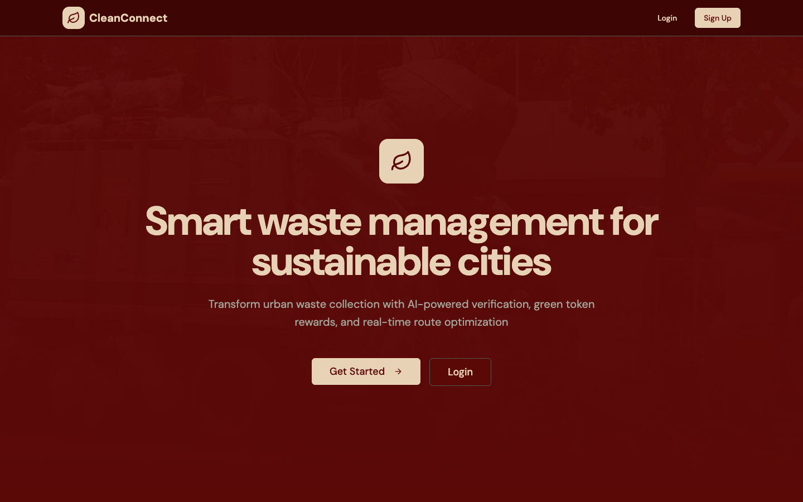
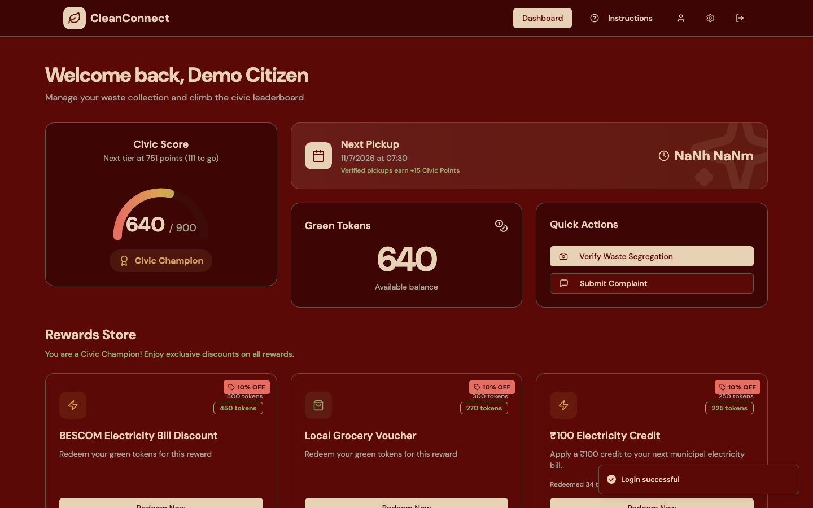
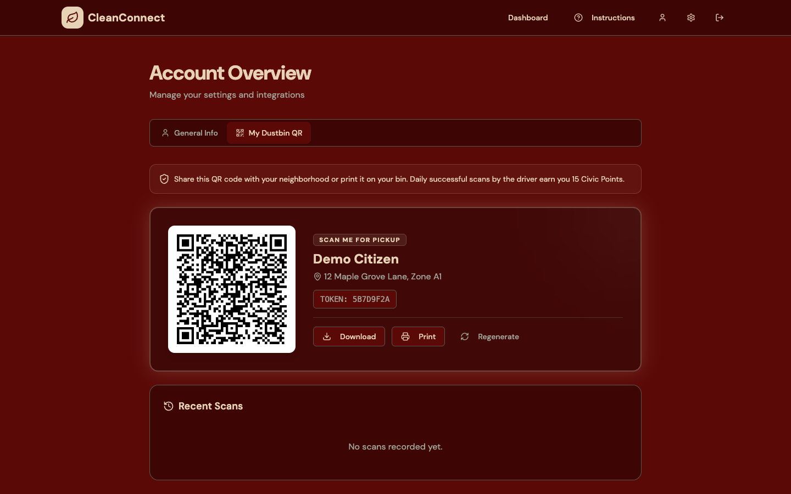
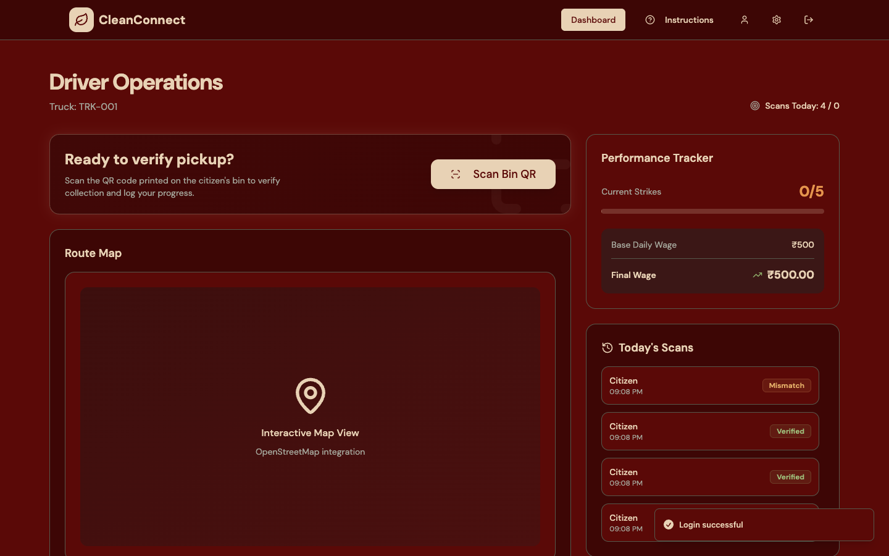
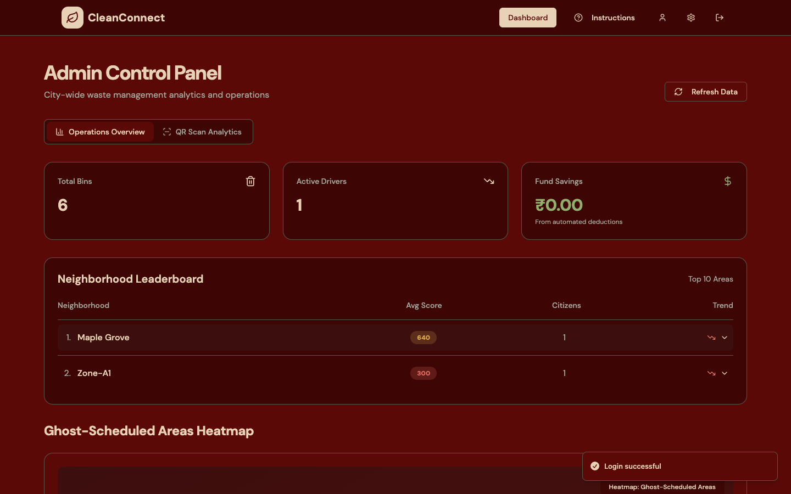
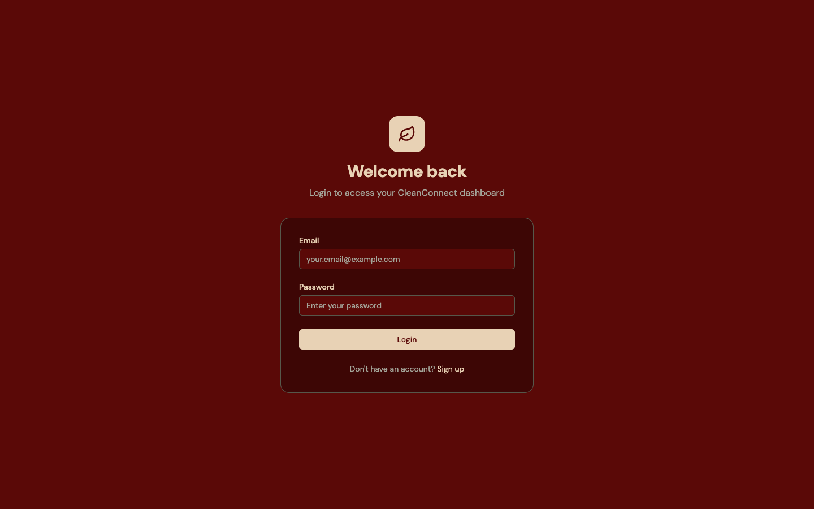
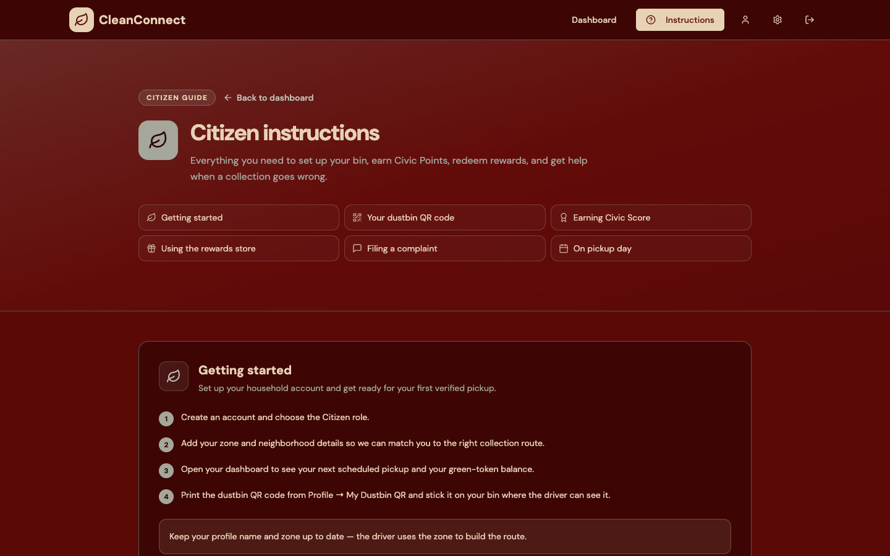
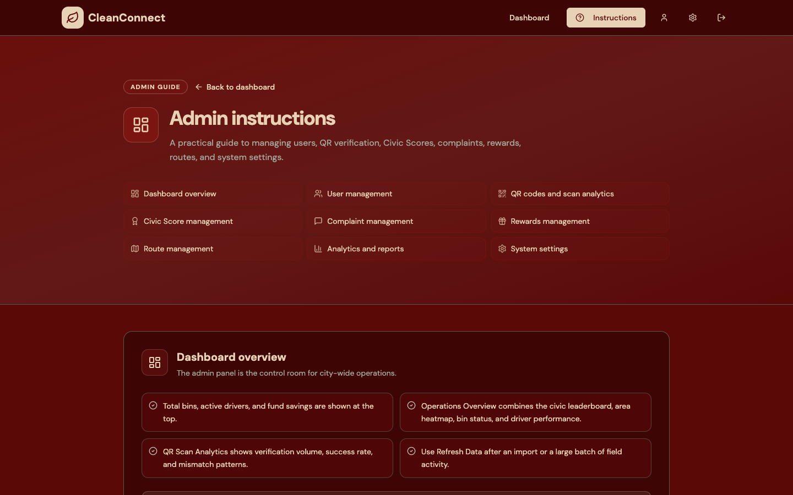

# CleanConnect

**Verified waste collection for cleaner cities.**

CleanConnect is a full-stack waste-management platform that connects citizens, collection drivers, and city administrators around one verifiable workflow: every pickup is confirmed by scanning the household bin's QR code within a GPS geofence, and every verified pickup earns Civic Points and green tokens.

The UI is built around a muted palette of **deep burgundy `#590907`**, **warm cream `#E8D2B5`**, and **sage grey `#A5A79B`**.



## Why it exists

Municipal waste collection is hard to audit. Trucks can skip streets, citizens can report a pickup that never happened, and supervisors have no reliable way to connect a driver's route to a household. CleanConnect makes the handoff explicit:

- The citizen generates a unique, rotatable QR code tied to their bin and its GPS location.
- The driver scans that code at the curb.
- The server records the scan together with the driver's GPS position and the calculated distance.
- A scan succeeds only inside a 50 m geofence (plus a capped allowance for GPS accuracy).
- Successful scans update the citizen's Civic Score, store a scan history, and feed driver payroll and admin analytics.

## Features

### Citizen
- Email/password signup with role selection and zone assignment.
- Personal dashboard with next pickup window, green token balance, and Civic Score arc.
- **My Dustbin QR** — generate, download, print, and rotate a bin QR code bound to a saved geofence.
- Scan history with driver, distance, and verification status.
- Waste proof upload for AI-assisted segregation verification.
- Rewards store with token redemption.
- Civic Score ledger with tier progression: Eco-Novice → Civic Champion → Elite Guardian.
- Complaints flow for missed or problematic collections.
- Role-specific instructions page.

### Driver
- Route map and assigned bins for the day.
- QR scanner with camera scan or manual token entry.
- Live GPS distance calculation and success / location-mismatch / invalid-token feedback.
- Today's scan log and performance tracker.
- Wage summary derived from verified scans and payroll adjustments.

### Admin
- City-wide operations overview: bins, drivers, citizens, and fund savings.
- Bin fill-level and overflow monitoring.
- QR scan analytics with status filtering and sorting.
- Citizen Civic Score table and leaderboard.
- Payroll adjustment and deduction tracking.
- Collection zones and route status.
- Role-specific admin guide.

### Platform
- PocketBase backend with schema migrations, access rules, and custom hooks.
- React + Vite frontend with Tailwind, Radix-based shadcn-style components, and Recharts.
- Responsive layouts and a single burgundy/cream/sage theme.
- Repeatable demo seed script for local screenshots and walkthroughs.

## Screenshots

| Citizen dashboard | Dustbin QR |
| --- | --- |
|  |  |

| Driver dashboard | Admin panel |
| --- | --- |
|  |  |

| Login | Citizen instructions |
| --- | --- |
|  |  |

| Admin instructions | |
| --- | --- |
|  | |

## Tech stack

| Layer | Technology |
| --- | --- |
| Frontend | React 18, Vite 7, React Router 7 |
| Styling | Tailwind CSS 3, shadcn-style Radix UI components |
| Charts | Recharts |
| Animation | Framer Motion |
| QR | `qrcode.react`, `jsqr` |
| Backend | PocketBase 0.38 |
| Database | PocketBase SQLite (schema in `pb_migrations`) |

## Repository layout

```text
.
├── apps/
│   ├── pocketbase/           # PocketBase schema migrations, hooks, and server package
│   └── web/                  # React + Vite frontend
├── docs/screenshots/         # README screenshots
├── scripts/seed-demo.mjs     # Idempotent local demo data seeder
├── package.json              # npm workspaces + convenience scripts
└── README.md
```

## Getting started

### Prerequisites

- Node.js 22+ and npm 10+
- A PocketBase 0.38 binary for your platform
- A browser with geolocation for the full QR flow

### 1. Install dependencies

```bash
npm install
```

### 2. Set up PocketBase

Download the PocketBase binary from the [v0.38.0 release](https://github.com/pocketbase/pocketbase/releases/tag/v0.38.0) and place it at `apps/pocketbase/pocketbase`:

```bash
chmod +x apps/pocketbase/pocketbase
```

Create the local environment file:

```bash
cd apps/pocketbase
cp .env.example .env
```

Edit `.env` and set values:

```dotenv
PB_ENCRYPTION_KEY=replace-with-a-32-character-secret
PB_SUPERUSER_EMAIL=admin@cleanconnect.local
PB_SUPERUSER_PASSWORD=change-this-password
```

`PB_ENCRYPTION_KEY` must be exactly 32 characters. The superuser values are read by the first migration, so set them before starting PocketBase with an empty data directory.

### 3. Configure the frontend

```bash
cd apps/web
cp .env.example .env.development
```

The default points at the local PocketBase server:

```dotenv
VITE_POCKETBASE_URL=http://127.0.0.1:8090
```

### 4. Run the app

From the repository root, with the PocketBase environment variables exported:

```bash
set -a
source apps/pocketbase/.env
set +a

npm run dev
```

This starts:

- PocketBase at `http://127.0.0.1:8090`
- Vite at `http://127.0.0.1:3000`

### 5. Seed demo data

In a second terminal:

```bash
PB_SUPERUSER_EMAIL=admin@cleanconnect.local \
PB_SUPERUSER_PASSWORD='your-superuser-password' \
npm run seed:demo
```

The seed script is idempotent. It creates or updates:

- 3 demo users (citizen, driver, admin)
- Citizen profile, 640 green tokens, pickup window, and Civic Score of 640
- Driver profile, truck, wallet, and active ZONE-A1 route
- 3 zones and 6 bins with mixed fill levels
- 6 rewards
- 1 active bin QR token with a saved geofence
- 4 QR scan records and 3 Civic Score ledger entries
- 1 payroll adjustment

### Demo accounts

| Role | Email | Password |
| --- | --- | --- |
| Citizen | `citizen@demo.local` | `Demo12345!` |
| Driver | `driver@demo.local` | `Demo12345!` |
| Admin | `admin@demo.local` | `Demo12345!` |

> Demo credentials are for local development only. Do not reuse them in production.

## QR verification flow

1. A citizen opens **Profile → My Dustbin QR** and generates a token. The browser captures the bin's GPS location and stores both the token and geofence.
2. The token is rendered as a QR code. The citizen can download or print it.
3. On collection day, the driver opens **Scan Bin QR**.
4. The driver scans the code (or types the token) while standing at the bin.
5. CleanConnect calculates the Haversine distance between the driver and the bin:

   ```text
   allowed radius = 50 m + min(GPS accuracy, 30 m)
   ```

6. The scan is saved as `success`, `location_mismatch`, or `invalid_token`.
7. A successful scan awards Civic Points and appears in both the citizen's and driver's histories.

Regenerating a QR code deactivates every previous token for that citizen.

## Scripts

| Command | Description |
| --- | --- |
| `npm run dev` | Run the web app and PocketBase together |
| `npm run build` | Build the frontend |
| `npm run lint` | Lint the frontend |
| `npm run start` | Preview the production build |
| `npm run seed:demo` | Seed or refresh local demo data |

## Data and security notes

- Do **not** commit `pb_data`, PocketBase binaries, or real `.env` files. They are excluded by `.gitignore`.
- Access rules live in `apps/pocketbase/pb_migrations`. Review them before deploying.
- QR tokens are 64-character SHA-256 hex strings and should be rotated if a bin sticker is lost.
- The geofence is intentionally tolerant of phone GPS error, but it is still a distance check, not cryptographic proof of presence.
- `PB_ENCRYPTION_KEY` protects PocketBase data at rest. Losing it makes encrypted data unrecoverable; never commit it.
- Uploaded proof-of-waste images are stored in PocketBase and should be handled according to your local privacy policy.

## Deployment

The frontend is a static Vite build and can be hosted on any static platform. PocketBase needs a persistent volume for `pb_data` and the same environment variables described above.

Hostinger deployments serve PocketBase under `/hcgi/platform`; the frontend falls back to that path when `VITE_POCKETBASE_URL` is not set.

## License

[MIT](LICENSE)
