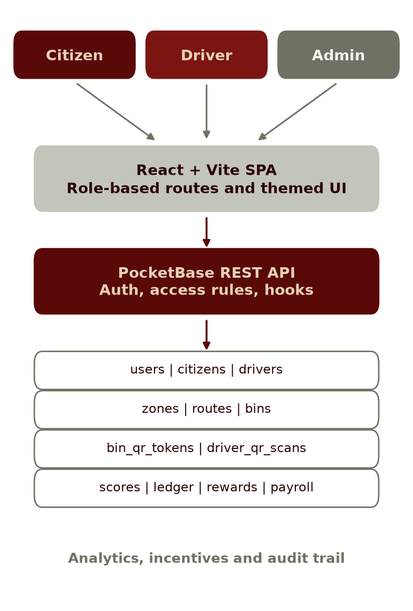
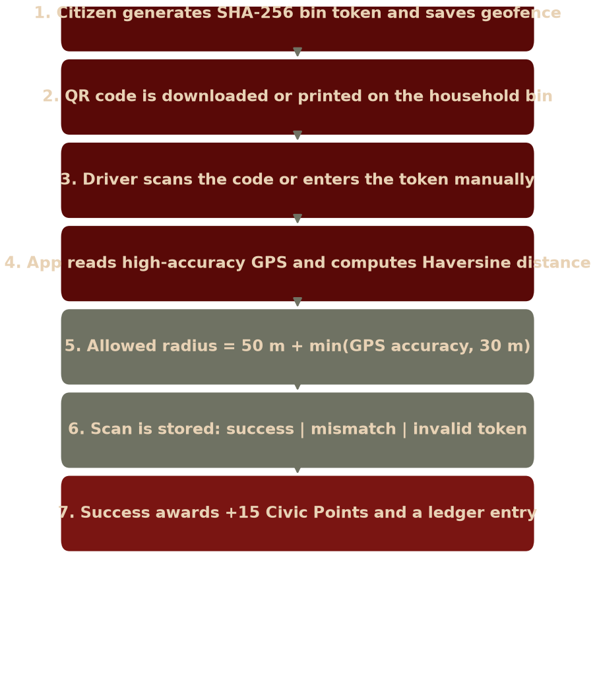
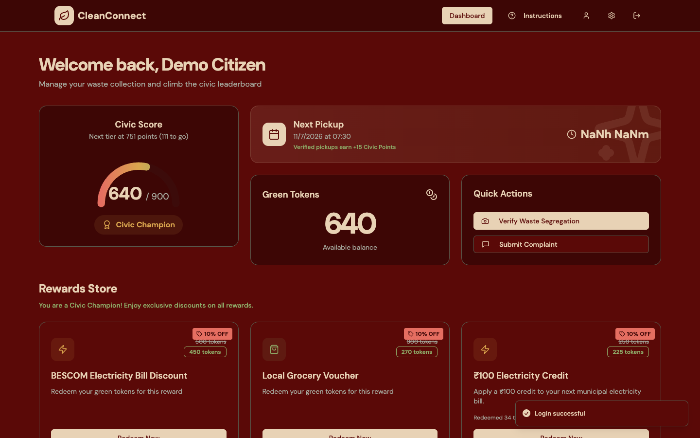
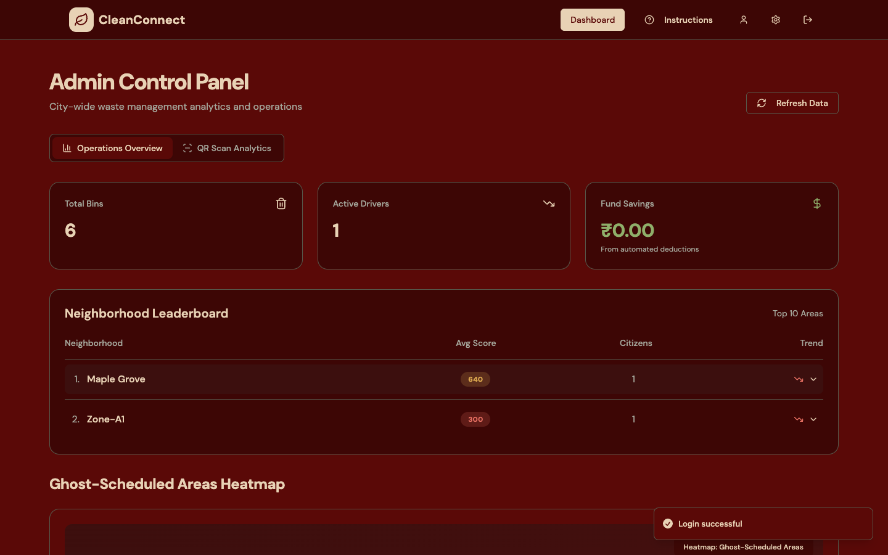

# CleanConnect: QR- and Geofence-Verified Waste Collection with Civic Incentives

**Author:** Mayank Jain  
**Affiliation:** Independent Project, CleanConnect Research and Development

## Abstract

Urban waste collection systems often lack verifiable, household-level accountability. Missed pickups are difficult to prove, driver routes are opaque, and citizens have little feedback when they participate correctly. This paper presents CleanConnect, a role-based web platform that verifies each collection by scanning a household bin QR code inside a GPS geofence. The system computes Haversine distance between the driver and the bin, tolerates phone GPS error with a capped accuracy buffer, records the verification outcome, and awards Civic Points to the household. A PocketBase backend stores role-specific data, enforces collection access rules, and supports dashboards for citizens, drivers, and administrators. The frontend is implemented with React, Vite, Tailwind CSS, and Recharts using a burgundy, cream, and sage visual system. We describe the architecture, verification workflow, incentive model, and a reproducible demo dataset. Validation includes automated lint and production build checks, a passing continuous-integration pipeline, eight interface screenshots, and an idempotent seed script. The results show that a low-cost QR and smartphone GPS workflow can provide actionable auditability without dedicated bin sensors. Limitations such as GPS spoofing, offline operation, and proof-image authenticity are discussed, followed by future work toward pilot deployment.

**Index Terms:** civic technology, geofencing, QR codes, smart cities, waste management, PocketBase, React

## I. INTRODUCTION

Municipal solid-waste collection is a high-frequency public service, yet its quality is usually measured at the route level rather than at the household level. A truck may pass a street without collecting a specific bin, a citizen may report a collection that did not occur, and supervisors may have no timestamped evidence linking a driver, a bin, and a location. These gaps weaken accountability and make incentive programs difficult to operate fairly.

CleanConnect addresses this gap with a lightweight verification loop. Each household generates a unique QR token bound to a saved bin location. During collection, the driver scans that token at the curb. The application reads the driver's GPS position, computes the distance to the bin, and records the scan as successful, location-mismatched, or invalid. Successful scans update the citizen's Civic Score and feed driver payroll and administrator analytics.

The paper makes five contributions: (1) a role-based web application for citizens, drivers, and administrators; (2) an accuracy-aware geofence verification workflow using QR codes and smartphone GPS; (3) a Civic Points incentive model backed by an immutable-style ledger; (4) operational dashboards for scan analytics, bin fill levels, routes, and payroll; and (5) a reproducible demo dataset and CI workflow that support research demonstration and hackathon submission.

The remainder of this paper is organized as follows. Section II reviews related work. Section III describes the system architecture. Section IV presents the implementation methodology. Section V reports validation results. Section VI discusses limitations and ethical considerations, and Section VII concludes with future work.

## II. BACKGROUND AND RELATED WORK

Smart waste-management research has largely focused on sensor-enabled bins, route optimization, and city-scale monitoring. Surveys of IoT-enabled waste systems describe ultrasonic fill-level sensors, GPS-enabled trucks, and centralized dashboards [1], [2]. These approaches can improve collection efficiency, but they require dedicated hardware, maintenance, and connectivity for every bin. CleanConnect deliberately uses commodities that most participants already carry: a printed QR sticker and a smartphone with geolocation.

Civic gamification literature shows that points, badges, and feedback loops can encourage pro-environmental and community behavior [3], [4]. CleanConnect applies this idea through Civic Points, tier progression, a public-facing score arc, and a rewards store. Unlike a purely motivational interface, the incentive is triggered by a verifiable event: the geofenced pickup scan.

Distance verification uses the Haversine formula, a standard great-circle distance method for latitude and longitude pairs [5]. The browser Geolocation API supplies position and an accuracy estimate [9]. By adding a capped accuracy buffer to a 50 m base radius, the system reduces false rejections from imprecise phone GPS while keeping the geofence meaningful.

The implementation uses React and Vite for the client [6], [7], Tailwind CSS for styling [8], qrcode.react and jsQR for QR generation and decoding [10], [11], and PocketBase for the backend [12]. This combination reduces deployment complexity: the client is a static build, while PocketBase provides authentication, a SQLite database, REST endpoints, migrations, and server-side hooks.

## III. SYSTEM ARCHITECTURE

CleanConnect is a three-role, client-server application. Citizens manage household profile data, generate a bin QR code, upload waste proof, and redeem rewards. Drivers view assigned routes and bins, then scan QR codes during collection. Administrators monitor city-wide operations, citizens, scan history, scores, and payroll. All roles share a single React client whose routes are protected by role checks.

Figure 1 summarizes the architecture. The React and Vite frontend communicates with PocketBase over REST. PocketBase enforces collection access rules, runs schema migrations, and executes custom hooks. Its SQLite collections store identity, routes, bins, QR tokens, scans, Civic Scores, rewards, complaints, verifications, and payroll adjustments.

| Collection | Purpose | Key fields |
| --- | --- | --- |
| users | Identity and role | email, role, zone_id, truck_number |
| citizens / drivers | Profiles and balances | green_tokens, neighborhood, truck, strikes |
| zones / routes | Service geography | zone_name, assigned_date, collection_status |
| bins | Collection points | zone_id, fill_level, status, last_cleared |
| bin_qr_tokens | Rotatable bin credentials | qr_token, geofence_lat/lng, is_active |
| driver_qr_scans | Pickup evidence | scan_status, distance_meters, is_location_valid |
| civic_scores / ledger | Incentive state | current_score, tier_rank, points_changed, reason |
| rewards / redemptions | Token economy | token_cost, tokens_spent, redemption_date |
| payroll_adjustments | Driver wage | strike_count, deduction_amount, final_wage |

### A. Frontend

The frontend uses React 18, React Router 7, Tailwind CSS 3, Radix-based interface components, Recharts, Framer Motion, and Sonner notifications. The visual system is defined by CSS variables and Tailwind tokens: deep burgundy #590907 for primary surfaces, warm cream #E8D2B5 for text and primary actions, and sage #A5A79B for secondary text and borders. The client falls back to the /hcgi/platform PocketBase path when no development URL is configured, which supports Hostinger-style deployments.

### B. Backend and data model

PocketBase 0.38 supplies authentication for the users collection plus typed base collections. Migrations under apps/pocketbase/pb_migrations define the schema and seed default rewards; hooks under apps/pocketbase/pb_hooks add migration utilities, external dashboard routing, and mailer behavior. Table I lists the core collections and their purpose.

### C. Role-based workflows

Protected routes map each role to its workspace: /citizen-dashboard, /driver-dashboard, and /admin-panel. The /instructions route redirects to a role-specific guide. Profile and settings pages are shared, while the dustbin QR tab is exposed only to citizens. This separation keeps sensitive operations such as payroll adjustment and scan analytics in the administrator workspace.

## IV. IMPLEMENTATION AND METHODOLOGY

The verification workflow was designed to be reproducible with no dedicated bin hardware. Figure 2 shows the complete loop from token generation to reward issuance.

### A. QR token lifecycle

A citizen opens Profile -> My Dustbin QR and requests a token. The client combines the citizen identifier, house address, timestamp, and a UUID, then hashes the string with SHA-256 through the Web Crypto API. The resulting 64-character hex token is stored with the house address and the GPS coordinates captured at the bin. Regenerating a token deactivates all previous active tokens for that citizen, and the QR code can be downloaded or printed.

### B. Geofence verification

The driver scans the QR code with the browser camera using jsQR, or enters the token manually. The client requests a high-accuracy GPS reading and computes the Haversine distance to the stored bin location. The effective radius is 50 m plus the device-reported accuracy, capped at an additional 30 m. A scan is stored as success, location_mismatch, or invalid_token, together with driver, citizen, coordinates, distance, and validity flag. Camera failure, missing location, or token lookup failure are handled explicitly so the driver receives actionable feedback.

### C. Civic Score and rewards

The reward model uses a bounded score from 300 to 900. A verified pickup awards 15 points, accurate segregation awards 30 points, a streak bonus adds 5 points, and a false complaint subtracts 50 points. Scores map to Eco-Novice, Civic Champion, and Elite Guardian tiers. Each change writes a ledger entry with reason and timestamp. Citizens redeem green tokens in a rewards store; redemption records and token balances are stored in PocketBase.

### D. Analytics and payroll

The administrator panel merges bins, drivers, citizens, scores, payroll adjustments, and ledger entries into operational views. Scan analytics support filtering by status and sorting by time. Bin cards show fill level and status, while payroll adjustments support strike counts, deduction percentages, deduction amounts, and final wage. The performance tracker gives drivers a daily view of scans, deductions, and wage.

### E. Validation setup

A seed script creates or refreshes a coherent local dataset: three demo users, citizen and driver profiles, three zones, six bins, an active QR token, a route, scan history, a Civic Score with ledger entries, rewards, and a payroll adjustment. The script is idempotent, which makes screenshots, demos, and automated checks repeatable.

## V. EVALUATION AND RESULTS

The system was evaluated on a local development stack with Vite on port 3000 and PocketBase on port 8090. Validation combined static checks, build checks, CI execution, browser rendering inspection, and a seeded functional dataset. Table II summarizes the checks.

| Check | Method | Result |
| --- | --- | --- |
| Lint | npm run lint | Passed |
| Production build | npm run build | Passed, 2092 modules |
| CI | GitHub Actions on main | all runs passed |
| Screenshots | 8 pages at 1440 x 900 | Validated |
| Theme | Computed browser styles | Palette confirmed |
| Seed | npm run seed:demo | Idempotent |

| Artifact | Seeded value |
| --- | --- |
| Demo users | 3 role accounts + local extras |
| Zones / routes | 3 / 1 active route |
| Bins | 6 (stable, critical, overflowing) |
| Active QR token | 1 with saved geofence |
| QR scans | 4 (3 success, 1 mismatch) |
| Civic score | 640, Civic Champion |
| Ledger entries | 3 |
| Rewards / payroll | 6 / 1 |

### A. Functional and build validation

ESLint reported no errors with npm run lint. The production build completed successfully, producing a CSS bundle of approximately 93 kB and a JavaScript bundle of approximately 798 kB before gzip. GitHub Actions ran lint and build on every push to main; both CI runs passed. Eight screenshots were captured at 1440 x 900 pixels across home, login, citizen dashboard, citizen instructions, dustbin QR, driver dashboard, admin panel, and admin instructions pages. Computed browser styles confirmed the burgundy background rgb(90, 9, 7), cream text rgb(232, 210, 181), and sage secondary text rgb(164, 166, 155).

### B. Demo dataset

Table III reports the seeded dataset used for evaluation and screenshots. The dataset intentionally includes both successful and failed scans so that analytics and feedback states are visible during a demonstration.

### C. Interface evidence

Figure 3 shows the citizen dashboard with pickup countdown, green-token balance, Civic Score arc, and rewards. Figure 4 shows the administrator panel with operational statistics and scan analytics. Both are rendered directly from the seeded local instance, not from static mockups.

## VI. LIMITATIONS AND ETHICAL CONSIDERATIONS

The current geofence is based on browser-reported GPS. A determined participant could spoof location or photograph and share a QR token. The capped accuracy buffer improves usability but does not establish cryptographic proof of physical presence. Future deployments should combine server-side location attestation, token rotation, anomaly detection, and occasional supervisor audits.

Proof-of-waste verification in the citizen camera flow is currently simulated in the client; no trained model is bundled. Location data and proof images are personal information and should be retained only as long as necessary, with clear consent and access controls. The encryption key for PocketBase must be stored outside version control, and losing it makes encrypted data unrecoverable.

The application assumes connectivity during collection. A production deployment for areas with unstable mobile networks would need an offline queue with signed events and later reconciliation. The current role rules are suitable for a prototype; a municipal pilot should add stronger audit logging, role administration, and penetration testing.

## VII. CONCLUSION AND FUTURE WORK

CleanConnect demonstrates that household-level waste-collection verification can be implemented with inexpensive, widely available technology. A QR token tied to a saved geofence, combined with an accuracy-aware Haversine check, creates an auditable link between citizen, driver, time, and place. The resulting scan event powers Civic Points, rewards, performance tracking, and administrative analytics in one role-based application.

Future work includes an offline-first progressive web app, server-verified location challenges, image-based waste-segregation classification, dynamic route optimization, carbon-credit integration, and a controlled pilot study with a municipality. Usability testing with sanitation workers and residents will be essential to refine the scanner flow and incentive design before production rollout.

## References

[1] N. Srikantha, Waste management in IoT-enabled smart cities: A survey, International Journal of Engineering and Computer Science, 2017, doi: 10.18535/ijecs/v6i5.53.

[2] A. A. Selvaraj, Smart waste management using IoT, International Journal for Research in Applied Science and Engineering Technology, vol. 7, no. 3, pp. 86-90, 2019, doi: 10.22214/ijraset.2019.3015.

[3] S. Rehm, M. Foth, and P. Mitchell, DoGood: examining gamification, civic engagement, and collective intelligence, AI and Society, vol. 33, no. 1, pp. 27-37, 2018, doi: 10.1007/s00146-017-0711-x.

[4] M. Romano, P. Diaz, and I. Aedo, Emergency management and smart cities: Civic engagement through gamification, in Lecture Notes in Business Information Processing, Springer, 2016, pp. 3-14, doi: 10.1007/978-3-319-47093-1_1.

[5] R. W. Sinnott, Virtues of the Haversine, Sky and Telescope, vol. 68, no. 2, p. 158, 1984.

[6] React, React documentation. [Online]. Available: https://react.dev/. Accessed: Nov. 17, 2026.

[7] Vite, Vite documentation. [Online]. Available: https://vite.dev/. Accessed: Nov. 17, 2026.

[8] Tailwind CSS, Tailwind CSS documentation. [Online]. Available: https://tailwindcss.com/docs. Accessed: Nov. 17, 2026.

[9] MDN Web Docs, Geolocation API. [Online]. Available: https://developer.mozilla.org/en-US/docs/Web/API/Geolocation_API. Accessed: Nov. 17, 2026.

[10] zpao, qrcode.react. [Online]. Available: https://github.com/zpao/qrcode.react. Accessed: Nov. 17, 2026.

[11] cozmo, jsQR. [Online]. Available: https://github.com/cozmo/jsQR. Accessed: Nov. 17, 2026.

[12] PocketBase, PocketBase documentation. [Online]. Available: https://pocketbase.io/docs/. Accessed: Nov. 17, 2026.
